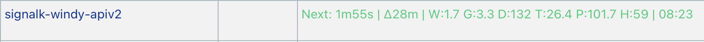

## Prerequisites

- **Set up your Signal K server** - [Signal K](https://signalk.org) is an open-source data server for boats. This guide is for a vessel whose Signal K server already receives position and weather data from the instruments on board.
- **Check the data your instruments provide** - the plugin reads the vessel position (`navigation.position`) and whichever of these your instruments deliver: wind speed, wind direction, outside temperature, pressure and humidity. A value your vessel does not have is simply not sent.
- **Register your station** - go to [My Stations](https://stations.windy.com/stations) and add a station for your vessel, if you do not have one yet.
- **Create an API key** - go to [API Keys](https://stations.windy.com/keys) and create a key. The plugin needs it to move your station on the map as the vessel moves.

## Steps

The exact menu names may vary depending on your Signal K server version.

1. Open the Signal K admin interface in your browser.
1. Navigate to **Apps & Plugins -> Store**, search for `signalk-windy-apiv2` and install it.
1. Restart the Signal K server.
1. Navigate to **Apps & Plugins -> Configuration** and select **Windy API v2 Reporter**.
1. Fill in the following fields:
   - **Station ID**: enter the _Station id_ of your station.
   - **Station Password**: enter the _Station password_ of your station.
   - **Global API Key**: enter the _API key_ you created.
   - **Display Name**: the name of your station on the Windy map, for example the name of your vessel.
   - **Share Option**: `Public` or `Windy only`.
   - **Reporting Interval (Minutes)**: `5` is the default and the minimum. Windy accepts one observation per station every 5 minutes. You can use a longer interval if needed.
1. Save your changes by clicking the `Save Configuration` button. Saving the configuration for the first time also enables the plugin.
1. Open the Signal K **Dashboard**. After about 15 seconds the line of the plugin shows the values it sent and a countdown to the next report.

You can find your _Station id_ and _Station password_ on the station detail page in Windy Stations: **My Stations -> station -> Connection**.

The plugin sends wind speed, gusts, wind direction, temperature, pressure and humidity. It also updates the position of your station when the vessel has moved more than 300 meters; you can change this distance in the plugin configuration.

After saving, your station should start sending data automatically. The first update may take a while before the station becomes active and starts showing live measurements on <a href="https://windy.com" target="_blank" rel="noopener noreferrer">windy.com</a>.

For all settings, the meaning of the dashboard line and troubleshooting, see the [plugin documentation](https://github.com/Peter-Petrik/signalk-windy-apiv2#readme).

Author: [Peter Petrik](https://github.com/Peter-Petrik)
