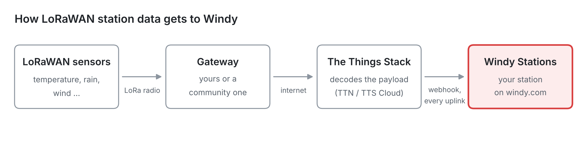
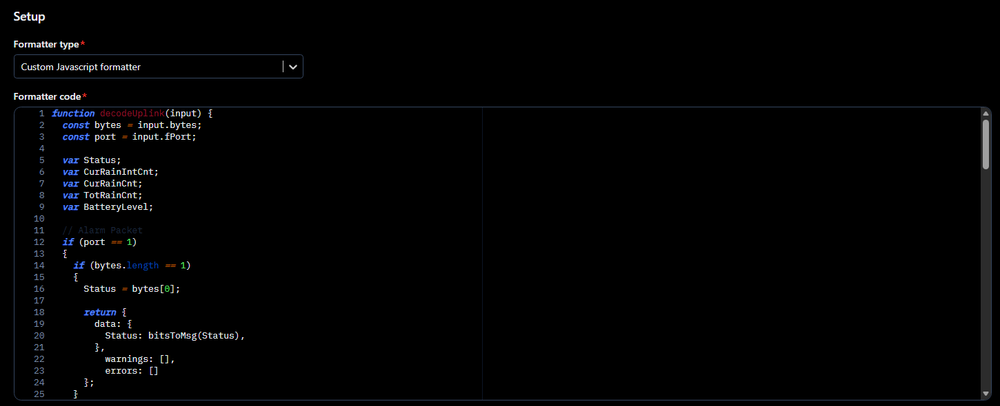
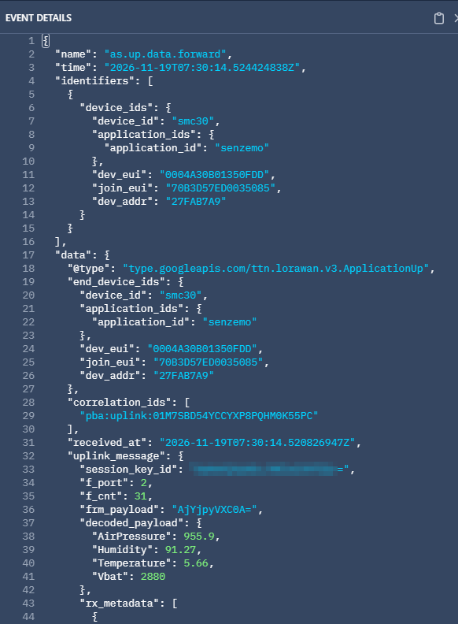
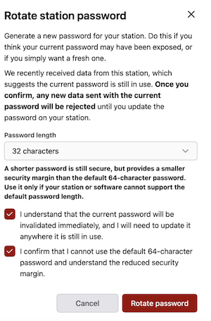
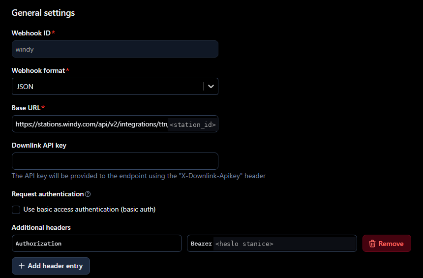
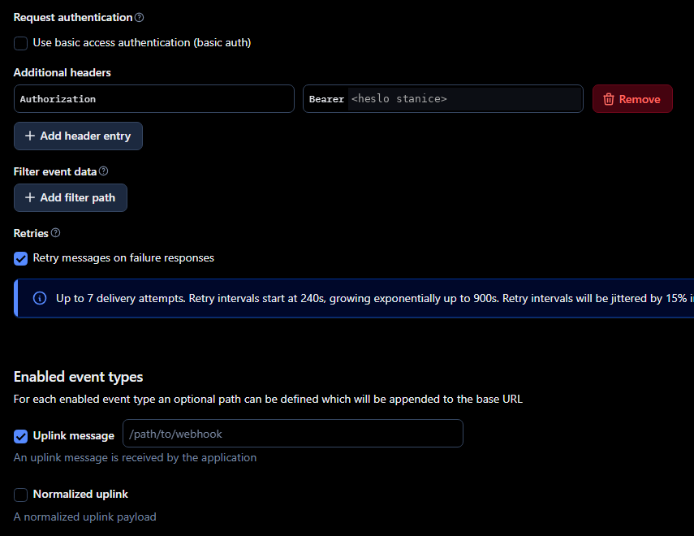
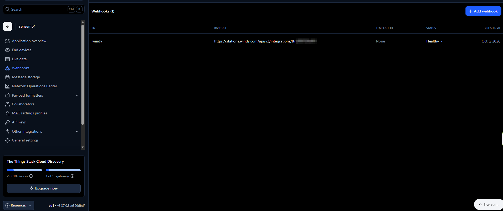

# The Things Network (LoRaWAN)

How to upload data from LoRaWAN weather sensors to windy.com using The Things Network or The Things Stack Cloud.

Windy receives your sensor data directly from The Things Stack through a webhook. You don't need your own server or any code. Several sensors in one TTN application (for example a temperature sensor and a rain gauge) are combined into one Windy station.

## Prerequisites

- **Register your sensors in The Things Stack** - your devices are added to an application in The Things Network (TTN) or The Things Stack Cloud, and they send uplinks through a gateway (yours or a community one).
- **Check that data is decoded** - open your application → **Live data** and click an uplink from each sensor. The event must contain `decoded_payload` with readable values (for example `"Temperature": 4.6`). If you only see raw bytes in `frm_payload`, set up a **Payload formatter** for the device first (from the LoRaWAN Device Repository or from your sensor manufacturer).

  

  

- **One application = one Windy station** - put all sensors of one weather station into the same TTN application. If you have sensors at different locations, use a separate application for each location.
- **Create a station on Windy** - go to [My Stations](https://stations.windy.com/stations), add a new station and fill in its location and the height of the sensors.
- **Get the Station ID and Station Password** - go to [My Stations](https://stations.windy.com/stations) and click your station. You will need both values in the next step.

  

## Steps

1. In The Things Stack Console, open your application and go to **Integrations → Webhooks** (in newer Console versions **Webhooks** is directly in the left menu).
1. Click **+ Add webhook** and select **Custom webhook**.
1. Fill in the fields:
   - **Webhook ID:** any name, for example `windy`
   - **Webhook format:** `JSON`
   - **Base URL:** `https://stations.windy.com/api/v2/integrations/ttn/<your Station ID>`
   - **Additional headers:** `Authorization` = `Bearer <your Station Password>` (the word `Bearer`, a space, then the password)

   

1. Under **Enabled event types**, check only **Uplink message** and leave its path empty.

   

1. Save the webhook with the button at the bottom of the form.

After saving, the webhook appears in the list with the status **Healthy**. Every uplink from your sensors is now sent to Windy automatically. The first data appear on your station page with the next uplink.

## Supported values

Windy reads the values from `decoded_payload` (and from the normalized payload, if your device provides one) and converts units automatically.

| Windy value | Recognized names in `decoded_payload` (examples) |
| --- | --- |
| Temperature (°C) | `temperature`, `temp`, `air_temperature`, `temperature_f` (°F) |
| Humidity (%) | `humidity`, `relativeHumidity`, `rh` |
| Pressure | `pressure`, `airPressure`, `barometric_pressure` (hPa or Pa) |
| Wind speed and gust (m/s) | `wind_speed`, `wind_gust`, `wind_speed_kmh` (km/h) |
| Wind direction (°) | `wind_direction`, `winddir` |
| Precipitation | `totalRain`, `rain_total`, `rain_cumulative` (cumulative counter in mm) |
| Dew point, UV, solar radiation | `dewpoint`, `uv`, `solar_radiation` |

Names are matched without regard to letter case, underscores and dashes (`AirPressure` = `air_pressure`).

## Good to know

- **Precipitation** is calculated as the total for the last hour from your rain gauge's cumulative counter. It appears about one hour after the first data arrive.
- **Invalid values are skipped one by one.** If a sensor sends an impossible value (for example −281 °C because of a wrong payload formatter), only that value is dropped and the rest is saved.
- Windy stores **at most one measurement every 5 minutes** per station. Values from more frequent uplinks are kept and sent with the next measurement.
- **A value older than 2 hours is not sent.** If one of your sensors stops sending, its values disappear from the station after 2 hours, while the other sensors keep reporting.
- **Simulated uplinks** from the Console are processed as real data and will appear on your station.

## Troubleshooting

- **The webhook shows errors in Live data** - click the failed event and check the status code. `401` means a wrong Station ID or Station Password.
- **No data on Windy** - check in **Live data** that your sensors still send uplinks and that the webhook is enabled for **Uplink message**.
- **Some values are missing** - your payload formatter probably uses names Windy doesn't recognize, or sends values in a different format. Check `decoded_payload` in Live data and compare it with the table above.
