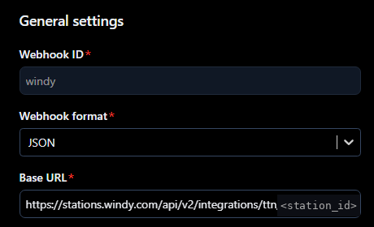
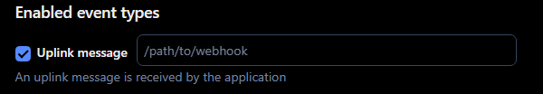

## Prerequisites

- **Set up your sensors in The Things Stack** - your LoRaWAN sensors are added to an application in The Things Network or The Things Stack Cloud, and their messages (uplinks) reach it through a gateway.
- **Use one application per weather station** - put all sensors of the station (for example a thermometer and a rain gauge) into the same application. Windy combines them into one station.
- **Check that the data is decoded** - in your application, open **Live data** and click a message from each sensor. It must contain `decoded_payload` with readable values, for example:

  ```json
  "decoded_payload": {
      "AirPressure": 955.9,
      "Humidity": 91.27,
      "Temperature": 5.66
  }
  ```

  If there is no `decoded_payload`, set up a **Payload formatter** for the device first (your sensor manufacturer provides one).

- **Create a station on Windy** - add a station in [My Stations](https://stations.windy.com/stations) with its location and the height of the sensors.

## Steps

1. In The Things Stack Console, open your application and go to **Webhooks** (in older versions **Integrations -> Webhooks**).
1. Click **+ Add webhook** and select **Custom webhook**.
1. Fill in the following fields:
   - **Webhook ID**: any name, for example `windy`.
   - **Webhook format**: `JSON`.
   - **Base URL**: `https://stations.windy.com/api/v2/integrations/ttn/` followed by your _Station id_, for example `https://stations.windy.com/api/v2/integrations/ttn/a1b2c3d4`.

   

1. Under **Additional headers**, click **+ Add header entry**:
   - **Key**: `Authorization`
   - **Value**: the word `Bearer`, a space and your _Station password_, for example `Bearer Xy7k...`.
1. Under **Enabled event types**, check only **Uplink message** and leave its path empty.

   

1. Click **Add webhook** at the bottom of the form.

You can find your _Station id_ and _Station password_ on the station detail page in Windy Stations: **My Stations -> station -> Connection**.

From the next sensor message on, the data appear on your station page in My Stations, and shortly after that on <a href="https://windy.com" target="_blank" rel="noopener noreferrer">windy.com</a>.

## Supported values

Temperature, humidity, pressure, wind speed, gust and direction, dew point, UV index, solar radiation and rain. Windy recognizes common names in `decoded_payload` (such as `Temperature`, `air_temperature` or `temperature_f`) and converts units (°F, km/h, hPa) automatically.

**Rain** must be a running total in mm (for example `totalRain` or `rain_total`). Windy calculates the rain of the last hour from it, so it appears about one hour after the first data. Rain per message is not supported.

## Good to know

- Windy saves at most one measurement every 5 minutes per station, with the latest value of each reading.
- If a sensor stops sending, its values disappear from the station after 2 hours.
- An impossible value (for example −281 °C from a wrong payload formatter) is skipped, the other values are saved.
- **Simulate uplink** in the Console sends real data to your station.

## Troubleshooting

- **The webhook shows errors in Live data** - click the failed event. `401` means a wrong _Station id_ or _Station password_.
- **Some values are missing** - check the names in `decoded_payload`. If Windy doesn't recognize them, rename them in your payload formatter (for example to `temperature`, `humidity`, `pressure`).
